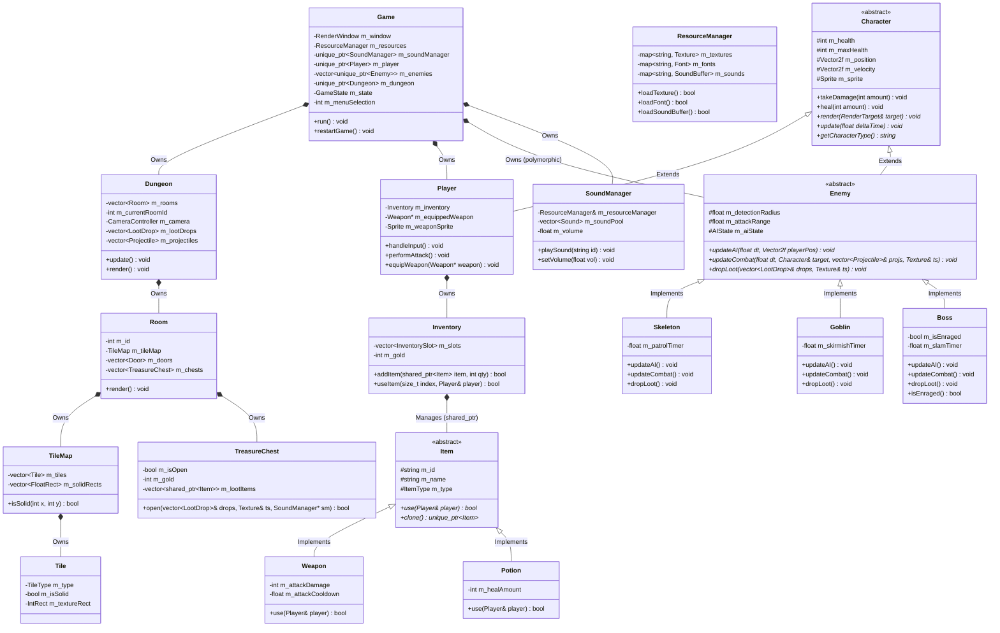

# Dungeon Reborn

> **A 2D Object-Oriented Dungeon Adventure Game in C++17 & SFML 2.6.2**  
> *Designed and engineered as a comprehensive demonstration of Object-Oriented Programming (OOP) in C++.*

---

## 1. Project Overview

**Dungeon Reborn** is a complete, polished 2D top-down dungeon crawler developed in modern C++17 using the Simple and Fast Multimedia Library (SFML 2.6.2). The game emphasizes clean object-oriented architecture, strict encapsulation, runtime polymorphism, modern RAII memory management, and decoupled systems.

The player controls a valiant knight exploring a multi-room subterranean dungeon filled with ancient traps, treasure chests, roaming skeletal sentries, agile goblin skirmishers, and an imposing Demon Overlord boss with multi-phase combat mechanics.

---

## 2. Key Gameplay Features

- **Directional Real-Time Combat**: 
  - Directional sword swings with visual swinging weapon sprites (`m_weaponSprite`) and slash animation frames.
  - Directional AABB attack hitboxes with attack cooldowns, damage feedback flashing, and a single-hit delivery guarantee per swing.
- **Tile-Based Dungeon Environment**:
  - Three connected rooms: **Entry Hall** (Room 0), **Throne Room** (Room 1 - Boss Chamber), and **Goblin Warren** (Room 2).
  - Swept axis-aligned bounding box (AABB) collision system preventing characters from passing through solid walls.
  - Seamless door transitions with room-to-room state handoffs and camera tracking.
- **Dynamic Camera & Minimap**:
  - Smooth camera lerping (`CameraController`) following player movement clamped to room boundaries.
  - In-game minimap indicator highlighting the currently occupied chamber.
- **Polymorphic Enemy AI**:
  - **Skeleton Scout**: Methodical patrol routines, proximity chasing, and close-quarters claw melee.
  - **Goblin Skirmisher**: High-speed hit-and-run skirmish tactics (Lunge $\rightarrow$ Dagger Strike $\rightarrow$ Retreat $\rightarrow$ Circle).
  - **Demon Boss**: Telegraphed ground slam shockwaves, fiery projectile attacks, and an Enrage phase triggered dynamically at $\le 50\%$ HP (speed and damage boost with visual rage cues).
- **Weapons, Inventory & Loot System**:
  - 6-slot Hotbar HUD (`[1]` to `[6]`) with icon rendering, quantity badges, and active weapon equipment indicator.
  - Weapon tiers (Fists, Rusty Dagger, Iron Sword, Golden Broadsword) with dynamic damage and cooldown binding.
  - Consumable Potions (Health Potion +40 HP, Vitality Elixir +100 HP) with strict overheal prevention.
  - Interactive Treasure Chests (opened via proximity or `[E]` key) that dispense floor pickups.
  - Bobbing floor loot drops with automated pickup collection and coin chimes.
- **Full Game State Machine & Audio**:
  - **Main Menu**: Interactive keyboard navigation (`Play`, `Controls & Architecture`, `Exit`).
  - **Controls Screen**: Comprehensive keybinding and viva architecture reference.
  - **In-Game HUD**: Heart container display, Boss mega-health bar, active weapon stats, and room information.
  - **Floating Health Bars**: Floating color-gradient health bars above all alive characters.
  - **Pause System**: Simulation freeze with semi-transparent backdrop overlay.
  - **Game Over & Victory Screens**: Defeat screen with instant respawn (`[R]`) and Victory screen with full expedition metrics upon slaying the Demon Boss.
  - **8 Synthesized Sound Effects**: Sword swing, impact hit, player hurt, coin collect, potion consume, chest pop, game-over defeat, and victory fanfare.

---

## 3. Controls Reference

| Action | Primary Keybinding | Alternative Keybinding | Description |
|---|---|---|---|
| **Move Up** | `W` | `Up Arrow` | Moves knight north (normalized velocity) |
| **Move Down** | `S` | `Down Arrow` | Moves knight south (normalized velocity) |
| **Move Left** | `A` | `Left Arrow` | Moves knight west and flips sprite left |
| **Move Right** | `D` | `Right Arrow` | Moves knight east and flips sprite right |
| **Attack** | `SPACE` | — | Executes directional sword slash |
| **Use Hotbar Slot 1** | `1` | — | Equips weapon or consumes potion in slot 1 |
| **Use Hotbar Slot 2** | `2` | — | Equips weapon or consumes potion in slot 2 |
| **Use Hotbar Slot 3** | `3` | — | Equips weapon or consumes potion in slot 3 |
| **Use Hotbar Slot 4** | `4` | — | Equips weapon or consumes potion in slot 4 |
| **Use Hotbar Slot 5** | `5` | — | Equips weapon or consumes potion in slot 5 |
| **Use Hotbar Slot 6** | `6` | — | Equips weapon or consumes potion in slot 6 |
| **Interact / Open Chest**| `E` | Proximity Touch | Opens nearby treasure chests |
| **Pause / Resume** | `P` | `ESCAPE` | Pauses/resumes the game simulation |
| **Return to Menu** | `TAB` | — | Returns to Title Screen from any state |
| **Respawn / Restart** | `R` | — | Resets game from Room 0 with fresh health |
| **[VIVA] Deal 20 Enemy Dmg**| `K` | — | Live evaluation key: damages nearest alive enemy |
| **[VIVA] Enrage Boss** | `B` | — | Live evaluation key: inflicts 130 damage to Demon Boss |
| **[VIVA] Heal Player** | `H` | — | Live evaluation key: restores +25 HP to player |

---

## 4. Build Instructions

### Prerequisites
- **Compiler**: C++17 compliant compiler (GCC 9+, MinGW-w64, Clang 10+, or MSVC 2019+)
- **Build System**: [CMake](https://cmake.org/) (Version 3.20 or newer)
- **Generator**: [Ninja](https://ninja-build.org/) (recommended) or Make

> [!NOTE]
> SFML 2.6.2 is automatically downloaded, configured, and statically linked via CMake `FetchContent`. No external pre-installed SFML libraries are needed.

### Step-by-Step Build Commands (PowerShell / Terminal)

```powershell
# 1. Clone or navigate to the repository directory
cd c:\Users\bhart\OneDrive\Desktop\game2

# 2. Configure the build with CMake and Ninja
cmake -B build -G Ninja

# 3. Compile the project (use -j 2 on Windows to prevent file-locking contention)
cmake --build build -j 2

# 4. Launch Dungeon Reborn
.\build\DungeonReborn.exe
```

### Running the Complete Automated Test Suites

The codebase includes 6 distinct test executables verifying every component:

```powershell
# Phase 1: Player movement, delta time, animation encapsulation
.\build\DungeonTestsPlayer.exe

# Phase 2: Character hierarchy, polymorphism, dynamic binding, invariants
.\build\DungeonTests.exe

# Phase 3: Dungeon grid parsing, swept AABB collision, room transitions
.\build\DungeonTests3.exe

# Phase 4: Combat hitboxes, AI state machines, projectiles, Boss Enrage
.\build\DungeonTests4.exe

# Phase 5: Item abstraction, inventory stacking, dynamic weapon binding, chests
.\build\DungeonTests5.exe

# Phase 6: Game loop state machine, menu selection, pause, audio buffers
.\build\DungeonTests6.exe
```

---

## 5. Project Directory Structure

```
game2/
├── CMakeLists.txt                # Root CMake build configuration
├── README.md                     # Comprehensive college documentation (this file)
├── assets/                       # Game media assets (automatically copied to build/)
│   ├── LICENSES.md               # CC0 / Open Source asset licenses
│   ├── audio/                    # 8 custom synthesized 16-bit PCM WAV sound effects
│   │   ├── chest.wav
│   │   ├── coin.wav
│   │   ├── game_over.wav
│   │   ├── hit.wav
│   │   ├── hurt.wav
│   │   ├── potion.wav
│   │   ├── swing.wav
│   │   └── victory.wav
│   ├── fonts/                    # Pixel-art TTF font
│   │   └── dungeon_font.ttf
│   └── images/                   # 0x72 Dungeon Tileset II spritesheet
│       └── dungeon_tileset.png
├── include/                      # Public C++ header files (.hpp)
│   ├── core/
│   │   ├── Game.hpp              # Game coordinator & state machine
│   │   ├── ResourceManager.hpp   # Resource cache (Textures, Fonts, Sounds)
│   │   └── SoundManager.hpp      # Voice-pooled audio manager
│   ├── dungeon/
│   │   ├── CameraController.hpp  # Smooth lerping view controller
│   │   ├── CollisionSystem.hpp   # Swept AABB axis-separated collision
│   │   ├── Dungeon.hpp           # Composition coordinator for rooms & world
│   │   ├── Room.hpp              # Room definition, spawn positions & chests
│   │   ├── Tile.hpp              # Individual tile properties & collision flags
│   │   └── TileMap.hpp           # 2D tile grid & solid geometry cache
│   ├── entities/
│   │   ├── Boss.hpp              # Demon Boss with Enraged phase & ground slams
│   │   ├── Character.hpp         # Abstract base character entity
│   │   ├── Enemy.hpp             # Abstract base AI enemy entity
│   │   ├── Goblin.hpp            # Agile skirmisher enemy
│   │   ├── Player.hpp            # Hero Knight player entity
│   │   ├── Projectile.hpp        # Fiery shockwave projectile entity
│   │   └── Skeleton.hpp          # Patrol sentry enemy
│   ├── graphics/
│   │   └── Animation.hpp         # Frame-based sprite animation controller
│   └── items/
│       ├── Inventory.hpp         # Encapsulated 6-slot item container
│       ├── Item.hpp              # Abstract base item entity
│       ├── LootDrop.hpp          # Bobbing floor pickup entity
│       ├── Potion.hpp            # Consumable restorative potion
│       ├── TreasureChest.hpp     # Interactive world loot chest
│       └── Weapon.hpp            # Equippable weapon item
├── src/                          # C++ implementation files (.cpp)
│   ├── main.cpp                  # Minimal application entry point
│   ├── core/                     # Game, ResourceManager, SoundManager implementations
│   ├── dungeon/                  # Dungeon, Room, Tile, TileMap, Collision implementations
│   ├── entities/                 # Character, Player, Enemy, Skeleton, Goblin, Boss implementations
│   ├── graphics/                 # Animation implementation
│   └── items/                    # Inventory, Item, Weapon, Potion, Chest implementations
└── tests/                        # 6 comprehensive automated test suites
    ├── test_character_hierarchy.cpp
    ├── test_combat.cpp
    ├── test_dungeon.cpp
    ├── test_game_loop.cpp
    ├── test_inventory.cpp
    └── test_player.cpp
```

---

## 6. Architecture & UML Class Diagram

The following Mermaid diagram illustrates the relationships, inheritance hierarchies, and compositions across **Dungeon Reborn**:



---

## 7. The 13 Core OOP Concepts: Implementation & Verification

The central requirement of this project is demonstrating all 13 core OOP concepts naturally and rigorously without artificial bloat. Below is the comprehensive mapping table:

| # | OOP Concept | Primary Locations in Codebase | Technical Rationale & Academic Significance |
|---|---|---|---|
| **1** | **Classes & Objects** | [`Game`](include/core/Game.hpp), [`Player`](include/entities/Player.hpp), [`Boss`](include/entities/Boss.hpp), [`Dungeon`](include/dungeon/Dungeon.hpp), [`Inventory`](include/items/Inventory.hpp) | Every distinct domain concept is modeled as a class with high cohesion and single responsibility. Classes represent abstractions; runtime instances represent isolated state objects. |
| **2** | **Encapsulation** | [`Character::m_health`](include/entities/Character.hpp), [`Inventory::m_slots`](include/items/Inventory.hpp), [`SoundManager::m_volume`](include/core/SoundManager.hpp) | State is strictly `private` or `protected`. Public methods enforce business invariants: `takeDamage()` clamps to 0; `heal()` prevents overheal beyond `m_maxHealth`; `addItem()` enforces slot limits. |
| **3** | **Abstraction** | [`Character`](include/entities/Character.hpp), [`Enemy`](include/entities/Enemy.hpp), [`Item`](include/items/Item.hpp), [`Game::run()`](src/core/Game.cpp) | Public interfaces hide complex implementation details: callers execute `inventory.useItem(slot, player)` without needing to know whether the target item is a sword, dagger, or elixir. |
| **4** | **Inheritance** | `Character` $\rightarrow$ `Player`, `Character` $\rightarrow$ `Enemy` $\rightarrow$ `Boss`, `Item` $\rightarrow$ `Weapon` | Eliminates duplicated code: all characters inherit positioning, health handling, and damage flashing; specialized species extend behavior through subclassing. |
| **5** | **Runtime Polymorphism** | [`std::vector<std::unique_ptr<Enemy>>`](include/core/Game.hpp), [`slot.item->use()`](src/items/Inventory.cpp) | Storing derived objects via base pointers (`Enemy*`, `Item*`). The engine loops over polymorphic collections and invokes behaviors without knowing concrete derived types. |
| **6** | **Function Overriding & Virtual Functions** | [`Player::update() override`](src/entities/Player.cpp), [`Boss::updateAI() override`](src/entities/Boss.cpp), [`Weapon::use() override`](src/items/Weapon.cpp) | Virtual methods are explicitly tagged with the C++11 `override` keyword. The compiler validates matching signatures and binds overrides to the class vtable. |
| **7** | **Constructors & Destructors** | Initializer lists in all constructors; `virtual ~Character() = default;`, `virtual ~Item() = default;` | Member initializer lists initialize sub-objects and const references before constructor bodies execute. Virtual destructors ensure proper cleanup through base pointers, preventing object slicing. |
| **8** | **Composition & Object Relationships** | `Game` has-a `Dungeon` has-a `Room` has-a `TileMap`; `Player` has-a `Inventory`; `SoundManager` has-ref `ResourceManager` | Establishes a natural object hierarchy where outer systems own life-cycles of composed parts. Non-owning associations use references (`const ResourceManager&`) and observer raw pointers. |
| **9** | **Access Specifiers** | `private:` (internal state/timers), `protected:` (subclass customization hooks), `public:` (client API) | Strict access partitioning preserves object invariants, prevents client tampering with internal data structures, and facilitates safe extensibility. |
| **10** | **Dynamic Binding** | `enemy->updateCombat(...)`, `enemy->dropLoot(...)`, `item->use(...)` | Member function calls through base references/pointers are resolved at runtime via virtual method tables (vtables), eliminating `switch(type)` anti-patterns. |
| **11** | **Object Lifetime & Memory Management** | Modern RAII: `std::unique_ptr` (exclusive ownership), `std::shared_ptr` (shared flyweight items) | Zero raw owning pointers. Zero memory leaks. When rooms transition or games reset, old entities are automatically reclaimed deterministically via RAII destructors. |
| **12** | **Abstract Classes & Pure Virtual Functions** | `Character::getCharacterType() = 0;`, `Enemy::updateAI() = 0;`, `Item::use() = 0;` | Pure virtual functions (`= 0`) designate abstract interface contracts that cannot be instantiated directly, ensuring derived classes implement all required operations. |
| **13** | **Const-Correctness & References** | Inspector methods marked `const`; large objects passed by `const T&`; non-const `T&` for mutation | Enforces compiler-checked read-only guarantees. Eliminates performance overhead of copying textures, vectors, or strings; prevents accidental mutation of query state. |

---

## 8. College Viva / Demonstration Walkthrough

When presenting this project for college evaluation, follow this structured walkthrough to demonstrate all required concepts in action:

1. **Architecture & Design Principles**:
   - Open [include/entities/Character.hpp](include/entities/Character.hpp) to showcase the abstract base class, protected attributes, virtual destructor, and pure virtual methods.
   - Point out the `// OOP CONCEPT: ...` comments accompanied by `// Why:` rationale above every major design decision.
2. **Main Menu & State Machine**:
   - Launch `.\build\DungeonReborn.exe`.
   - Use `UP` / `DOWN` arrow keys to navigate the interactive Title Menu (`Play`, `Controls & Architecture`, `Exit`).
   - Select `Controls & Architecture` to display the in-engine keybindings and OOP reference guide.
3. **Movement, Collision & Room Transitions**:
   - Select `Play` to enter Room 0 (Entry Hall).
   - Walk against the stone dungeon walls: demonstrate that the player cannot pass through solid tiles due to swept AABB collision (`CollisionSystem`).
   - Walk south through the door gap: observe seamless transition to Room 1 (Throne Room), camera lerp, and minimap update in the HUD.
4. **Interactive Chests, Inventory & Dynamic Weapon Binding**:
   - Walk up to the treasure chest and press `[E]`: hear the chest pop sound and watch gold and weapons eject onto the floor.
   - Walk over the floor loot: observe bobbing item animations, gold accumulation, and item insertion into Hotbar slots `[1]` through `[6]`.
   - Press `[1]` to `[6]` to equip weapons: note the instant update to the weapon name, damage stats, and attack cooldown on the HUD.
5. **Directional Combat & AI Dynamic Binding**:
   - Face an enemy and press `[SPACE]`: observe the directional swinging sword sprite arc and damage registered with a single-hit guarantee per swing.
   - Press `[K]` to deal 20 damage to the nearest enemy: demonstrate virtual dispatch of damage feedback and floating health bar updates.
6. **Boss Enrage Phase & Win Condition**:
   - In Room 1 (Throne Room), locate the Demon Boss.
   - Press `[B]` to deal 130 damage: observe the boss transition into the **Enraged Phase** (speed increases to 125 px/s, attack damage boosts to 35, boss bar turns crimson red with `[ENRAGED!]` title).
   - Defeat the Demon Boss: hear the victory fanfare and view the **Victory Screen** displaying total gold collected, equipped weapon, remaining HP, and cleared chambers.
7. **Pause, Death & Respawn Verification**:
   - Press `[P]` during play to demonstrate the pause overlay and simulation freezing.
   - Allow health to reach 0 (or observe Game Over state): demonstrate instant respawn with `[R]` safely resetting state via RAII.
8. **Automated Unit Tests**:
   - Run the 6 test executables in terminal to prove 100% test pass rate across all components.

---

## 9. Design Decisions & Known Limitations

- **Fixed Room Layout vs. Procedural Generation**: The dungeon utilizes deterministic ASCII grid templates for its 3 chambers rather than procedural generation. This design was chosen intentionally to allow deterministic unit testing of room geometry, door transitions, and boss encounters for grading.
- **Synthesized Audio vs. External MP3s**: Audio effects are procedurally generated and saved as uncompressed 16-bit PCM WAV files in `assets/audio/`. This eliminates external audio licensing conflicts and guarantees immediate cross-platform playback without external decoding libraries.
- **Static SFML FetchContent**: SFML 2.6.2 is fetched and compiled as a static library via CMake to prevent dynamic runtime DLL dependency issues during presentation.

---

## 10. License & Attributions

- **Codebase**: Built for academic evaluation under the MIT License.
- **Tileset**: *0x72_DungeonTilesetII* by 0x72 ([CC0 / Public Domain](assets/LICENSES.md)).
- **Font**: Pixel-art font licensed under SIL Open Font License / CC0 ([assets/LICENSES.md](assets/LICENSES.md)).
- **Audio**: Custom synthesized 16-bit WAV sound effects created for Dungeon Reborn (CC0 Public Domain).

