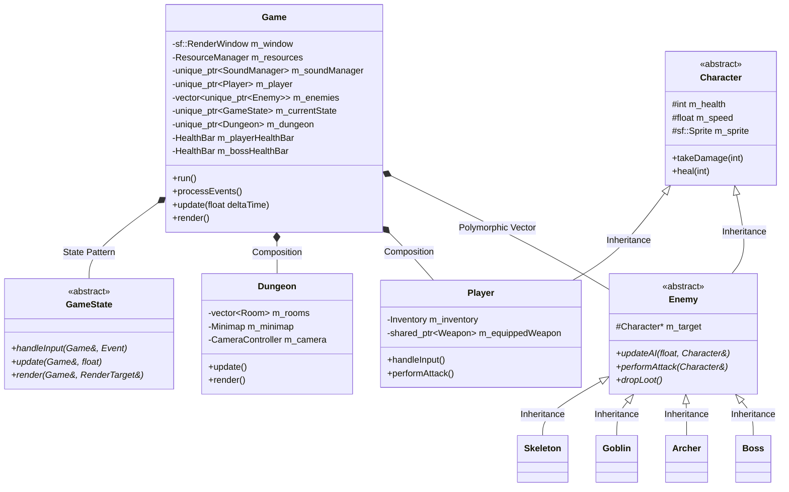
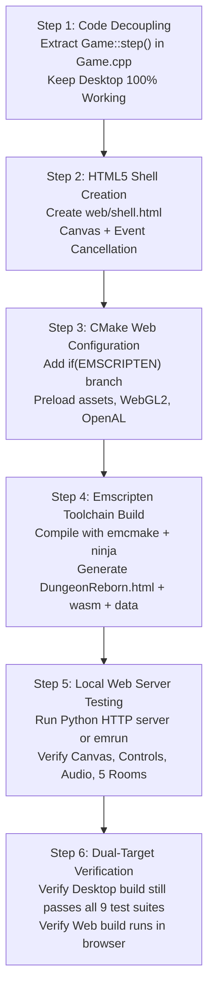

# Web Deployment Plan: Porting "Dungeon Reborn" to WebAssembly / Emscripten

> **Document Status**: Comprehensive Audit & Migration Blueprint  
> **Target Platform**: Modern Web Browsers (Chrome, Firefox, Safari, Edge) via WebAssembly (Wasm) + WebGL + Web Audio  
> **Core Constraint**: Preserve 100% of existing C++17 OOP Architecture (Inheritance, Polymorphism, Encapsulation, Abstraction, Composition) and ensure the existing Desktop build remains fully functional.

---

## 1. Executive Summary & Existing Architecture

### 1.1 Architectural Blueprint
"Dungeon Reborn" is built upon a layered, object-oriented design in C++17 utilizing SFML (Simple and Fast Multimedia Library):



### 1.2 Verification of Existing Desktop Version
Before analyzing web compatibility, the desktop version was compiled and tested:
- **Compiler**: MinGW GCC 14.2 64-bit with CMake 3.20+ and Ninja.
- **Test Suite Results**: All 9 unit test suites (`DungeonTests`, `DungeonTestsPlayer`, `DungeonTests3`, `DungeonTests4`, `DungeonTests5`, `DungeonTests6`, `DungeonTestsExploration`, `DungeonTestsEnemyAI`, `DungeonTestsPhase4`) passed with 100% success rate.
- **Runtime Check**: `run_game.bat` initiates `DungeonReborn.exe` smoothly at 60 FPS with full audio and visual systems operational.

---

## 2. In-Depth Compatibility Analysis: Desktop vs. WebAssembly

| Subsystem / Area | Desktop (Current Implementation) | WebAssembly / Emscripten Requirements | Compatibility Status |
|---|---|---|---|
| **1. Game Loop** | Blocking infinite while-loop (`while (m_window.isOpen() && m_isRunning)`) | Browser runs on a single-threaded asynchronous event loop; blocking freezes the browser tab. Requires `emscripten_set_main_loop_arg()`. | **Incompatible without refactoring** |
| **2. Windowing / Rendering** | OS native window via Win32 (`sf::Style::Titlebar \| sf::Style::Close`), Desktop OpenGL | HTML5 `<canvas>` element via WebGL 1.0 / WebGL 2.0 (OpenGL ES 2.0/3.0); window borders managed by CSS. | **Incompatible with Vanilla SFML** |
| **3. Graphics Backend** | Desktop OpenGL fixed-function pipeline (`glMatrixMode`, `glEnableClientState`) | WebGL/OpenGL ES strictly requires modern programmable shaders and vertex buffer objects (VBOs). | **Incompatible with Vanilla SFML 2.6** |
| **4. Asset Loading / Filesystem** | Reads files directly from local disk (`assets/images/...`, `assets/audio/...`) | Browser sandbox has no direct disk access. Requires Emscripten Virtual File System (`MEMFS`) via `--preload-file`. | **Compatible via CMake preload** |
| **5. Audio Backend** | Native OpenAL via `openal32.dll` bundled at runtime | OpenAL emulated via Web Audio API. Native DLLs cannot be loaded in WebAssembly. | **Compatible via Emscripten OpenAL layer** |
| **6. Audio Autoplay Policy** | Audio plays immediately at startup (`m_soundManager->playSound("coin")`) | Modern browsers suspend `AudioContext` until the first user interaction (click/keypress). | **Needs user-gesture unlock** |
| **7. Input & Event Polling** | Standard polling `sf::Keyboard::isKeyPressed()`, OS window events | Emscripten translates DOM key events to SFML events. Keys like `Space`, `ArrowKeys`, `Tab` cause page scrolling unless prevented. | **Compatible with key event prevention** |
| **8. Memory & Linker Flags** | MinGW static CRT flags (`-static -static-libgcc -static-libstdc++`) | Emscripten compiler (`emcc`/`em++`) flags: `-s WASM=1 -s ALLOW_MEMORY_GROWTH=1 -s USE_WEBGL2=1`. | **Build configuration change only** |
| **9. Platform APIs** | Zero Windows-specific headers (`windows.h`, `_WIN32` are not used). Standard C++17 STL. | Fully portable across POSIX, Linux, and WebAssembly. | **100% Portable** |

---

## 3. Specific Compatibility Problems & Technical Solutions

### Problem 1: The Blocking `while` Loop (Critical Blocker)
- **Current Code** ([`Game.cpp` lines 152–159](file:///c:/Users/bhart/OneDrive/Desktop/game2/src/core/Game.cpp#L152-L159)):
  ```cpp
  while (m_window.isOpen() && m_isRunning) {
      float deltaTime = m_clock.restart().asSeconds();
      if (deltaTime > 0.1f) deltaTime = 0.1f;
      processEvents();
      update(deltaTime);
      render();
  }
  ```
- **Why it breaks on Web**: Browsers execute JavaScript and WebAssembly on the main UI thread. A continuous synchronous loop blocks the browser from handling DOM events, repainting the page, or executing JavaScript timers. Within 5 seconds, the browser displays a "Page Unresponsive" crash prompt.
- **Solution**: Decouple a single frame step from the outer loop.
  - Implement `void Game::step()` encapsulating input, update, and render for exactly one frame.
  - Use conditional compilation with `#ifdef __EMSCRIPTEN__`:
    ```cpp
    #ifdef __EMSCRIPTEN__
    #include <emscripten.h>

    static void emscriptenUpdateLoop(void* userData) {
        Game* game = static_cast<Game*>(userData);
        game->step();
    }

    void Game::run() {
        // 0 = simulate infinite loop via requestAnimationFrame
        // 1 = do not block caller (yield control back to browser)
        emscripten_set_main_loop_arg(emscriptenUpdateLoop, this, 0, 1);
    }
    #else
    void Game::run() {
        while (m_window.isOpen() && m_isRunning) {
            step();
        }
    }
    #endif
    ```

---

### Problem 2: Upstream SFML 2.6.2 Lacks Native Emscripten Support
- **Current Situation**: `CMakeLists.txt` uses `FetchContent` to download official `SFML/SFML 2.6.2`. Official SFML 2.x only targets Windows (Win32), Linux (X11), and macOS (Cocoa). Its graphics module relies on desktop OpenGL calls (`glMatrixMode`, `glLoadIdentity`, etc.) that are unsupported in WebGL.
- **Solution Strategy**: Use the proven community Emscripten port of SFML:
  - **Option A (Recommended & Standard)**: Use the community-maintained Emscripten branch for SFML 2.6 (e.g., [`Zombieschannel/SFML`](https://github.com/Zombieschannel/SFML/tree/SFML-2.6.x-EMCC) or [`vittorioromeo/zancle`](https://github.com/vittorioromeo/zancle)). These branches replace Win32 window creation with Emscripten HTML5 canvas bindings and map SFML draw calls to OpenGL ES 2.0 / WebGL.
  - In `CMakeLists.txt`, we conditionally select the repository based on `if(EMSCRIPTEN)`:
    ```cmake
    if(EMSCRIPTEN)
        FetchContent_Declare(
            SFML
            GIT_REPOSITORY https://github.com/Zombieschannel/SFML.git
            GIT_TAG SFML-2.6.x-EMCC
        )
    else()
        FetchContent_Declare(
            SFML
            GIT_REPOSITORY https://github.com/SFML/SFML.git
            GIT_TAG 2.6.2
        )
    endif()
    ```
  - This allows the **exact same C++ game source code** to build for desktop with standard SFML and for the web with the Emscripten SFML port without modifying game logic!

---

### Problem 3: Asset Packaging & File System Virtualization
- **Current Code**:
  - `loadTexture("dungeon_tileset", "assets/images/dungeon_tileset.png")`
  - `loadFont("dungeon_font", "assets/fonts/dungeon_font.ttf")`
  - `loadSoundBuffer("hit", "assets/audio/hit.wav")`
- **Why it breaks on Web**: The browser cannot read `C:\Users\...\assets\...`.
- **Solution**: Emscripten provides a virtual in-memory file system (`MEMFS`). By passing the linker flag:
  ```cmake
  --preload-file "${CMAKE_CURRENT_SOURCE_DIR}/assets@/assets"
  ```
  Emscripten packages the `assets/` folder into `DungeonReborn.data`, downloads it asynchronously before `main()` starts, and mounts it at the virtual path `/assets`.
  **Result**: Every call to `loadFromFile("assets/...")` works automatically without altering a single file path in the C++ code!

---

### Problem 4: Browser Audio Autoplay Restrictions
- **Current Code**: `Game::Game()` plays `"coin"` sound immediately upon launch.
- **Why it breaks on Web**: All modern browsers block Web Audio from emitting sound until the user interacts with the page (clicks on the canvas or presses a key).
- **Solution**:
  - The game already launches into a **Title Screen** (`GameState::TitleScreen`).
  - When the user presses `[Enter]`, `[Space]`, or clicks to select "PLAY ADVENTURE", that user gesture automatically triggers the browser to resume the Web Audio `AudioContext`.
  - In `SoundManager.cpp`, we ensure failed early plays do not crash the engine, and when the first gesture occurs, audio plays cleanly.

---

### Problem 5: Browser Key Scrolling & Tab Focus
- **Current Code**: Player uses `WASD`, `Arrow Keys`, `Space`, `Tab`, and `1-6`.
- **Why it breaks on Web**: Pressing `Space` or `Down Arrow` scrolls the web page; pressing `Tab` jumps browser focus to the URL bar.
- **Solution**: In the custom HTML shell (`web/shell.html`), add a tiny JavaScript listener to prevent default browser actions on game keys:
  ```javascript
  window.addEventListener("keydown", function(e) {
      // Prevent scrolling on Space, Arrow Keys, and Tab
      if (["Space", "ArrowUp", "ArrowDown", "ArrowLeft", "ArrowRight", "Tab"].indexOf(e.code) > -1) {
          e.preventDefault();
      }
  }, { passive: false });
  ```

---

## 4. Files Requiring Modification vs. What Remains Unchanged

### What Can Remain 100% Unchanged
The vast majority of the project requires **zero modifications**:

- **Entities & Combat**: `Character.hpp/cpp`, `Player.hpp/cpp`, `Enemy.hpp/cpp`, `Skeleton.hpp/cpp`, `Goblin.hpp/cpp`, `Archer.hpp/cpp`, `Boss.hpp/cpp`, `EnemyFactory.hpp/cpp`, `Projectile.hpp/cpp`
- **Dungeon System**: `Dungeon.hpp/cpp`, `Room.hpp/cpp`, `Tile.hpp/cpp`, `TileMap.hpp/cpp`, `DungeonGenerator.hpp/cpp`, `CollisionSystem.hpp/cpp`, `CameraController.hpp/cpp`, `Minimap.hpp/cpp`
- **Inventory & Items**: `Inventory.hpp/cpp`, `Item.hpp/cpp`, `Weapon.hpp/cpp`, `Sword.hpp/cpp`, `Bow.hpp/cpp`, `MagicWeapon.hpp/cpp`, `Potion.hpp/cpp`, `Key.hpp/cpp`, `LootDrop.hpp/cpp`, `TreasureChest.hpp/cpp`
- **Interactables**: `Interactable.hpp`, `Door.hpp/cpp`, `KeyPickup.hpp/cpp`, `Trap.hpp/cpp`, `SpikeTrap.hpp/cpp`, `FireTrap.hpp/cpp`
- **Graphics & UI**: `Animation.hpp/cpp`, `HealthBar.hpp/cpp`
- **Game State Logic**: `GameState.hpp/cpp` (all 6 states: Menu, Controls, Playing, Paused, GameOver, Victory)

### Files Requiring Targeted Changes
Only **3 files** in the entire codebase require lightweight conditional changes:

1. **[`CMakeLists.txt`](file:///c:/Users/bhart/OneDrive/Desktop/game2/CMakeLists.txt)**:
   - Add `if(EMSCRIPTEN)` check.
   - For web target: set output suffix to `.html`, configure linker flags (`-s USE_WEBGL2=1`, `-s ALLOW_MEMORY_GROWTH=1`, `--preload-file assets@/assets`, `--shell-file web/shell.html`).
   - For desktop target: preserve current MinGW flags and post-build DLL copy.
2. **[`include/core/Game.hpp`](file:///c:/Users/bhart/OneDrive/Desktop/game2/include/core/Game.hpp)** & **[`src/core/Game.cpp`](file:///c:/Users/bhart/OneDrive/Desktop/game2/src/core/Game.cpp)**:
   - Declare and define `void step();` containing one frame's delta time calculation, event processing, update, and render.
   - Guard `Game::run()` with `#ifdef __EMSCRIPTEN__` to call `emscripten_set_main_loop_arg()` on web, and standard `while(m_window.isOpen())` on desktop.
3. **[`src/core/SoundManager.cpp`](file:///c:/Users/bhart/OneDrive/Desktop/game2/src/core/SoundManager.cpp)**:
   - Graceful handling of browser autoplay audio context suspension before initial user interaction.

### New Files to Add (Support / Tooling)
1. **`web/shell.html`**: A clean, responsive HTML5 template with:
   - Centered `<canvas id="canvas">` with responsive letterboxing ($3:2$ aspect ratio, max width $960\text{px}$, height $640\text{px}$).
   - Loading indicator / progress bar.
   - Keyboard default prevention (`preventDefault()`).
2. **`build_web.bat`**: A simple 1-click script to invoke Emscripten CMake (`emcmake cmake -B build_web`) and Ninja/Make to generate `DungeonReborn.html`.

---

## 5. Recommended Step-by-Step Migration Strategy



### Detailed Phase Breakdown

#### Phase 1: Game Loop Refactoring (Preserving Desktop Compatibility)
- Add `void step()` to `Game`.
- Ensure desktop `Game::run()` simply calls `step()` inside its existing `while` loop.
- Re-run all 9 test suites on Windows to ensure 0 regression.

#### Phase 2: Create Web Shell Template (`web/shell.html`)
- Provide a dark-themed, styled page suitable for a college portfolio or itch.io / GitHub Pages deployment.
- Include instructions banner with controls: `[WASD / Arrows]` to move, `[Space]` to attack, `[1-6]` for items, `[E]` for chests, `[P]` to pause.

#### Phase 3: Update `CMakeLists.txt`
- Enable dual-target compilation.
- When compiled with `emcmake cmake`, automatically target WebAssembly and package assets.
- When compiled with standard `cmake`, target native `DungeonReborn.exe`.

#### Phase 4: Build & Local Execution
- Build using Emscripten SDK (`emsdk`).
- Launch via a lightweight local server:
  ```powershell
  python -m http.server 8080 --directory build_web
  ```
- Navigate to `http://localhost:8080/DungeonReborn.html`.

---

## 6. OOP Principles Compliance Guarantee

The web port will **strictly preserve all 13 core OOP concepts**:

1. **Encapsulation**: State variables (`m_health`, `m_inventory`, `m_discoveredRooms`) remain strictly private. WebAssembly compiled code runs against the exact same memory layout.
2. **Abstraction**: Subsystems remain behind abstract interfaces (`GameState`, `Weapon`, `Interactable`, `Enemy`).
3. **Inheritance**: Full hierarchies (`Character -> Player, Enemy -> Skeleton, Goblin, Archer, Boss`) are completely unchanged.
4. **Runtime Polymorphism**: Virtual function dispatch (vtable) operates identically in WebAssembly as it does in native x64 machine code.
5. **Composition**: The object tree (`Game -> Dungeon -> Room -> TileMap -> Tile`) remains intact.
6. **Smart Pointer Memory Management**: RAII with `std::unique_ptr` and `std::shared_ptr` continues to guarantee automatic deterministic memory cleanup without manual deletes.

---

## 7. Next Action & User Approval
This completes the comprehensive inspection and compatibility audit. The existing desktop version is 100% operational and verified. We are ready to proceed with implementation whenever you are ready!

